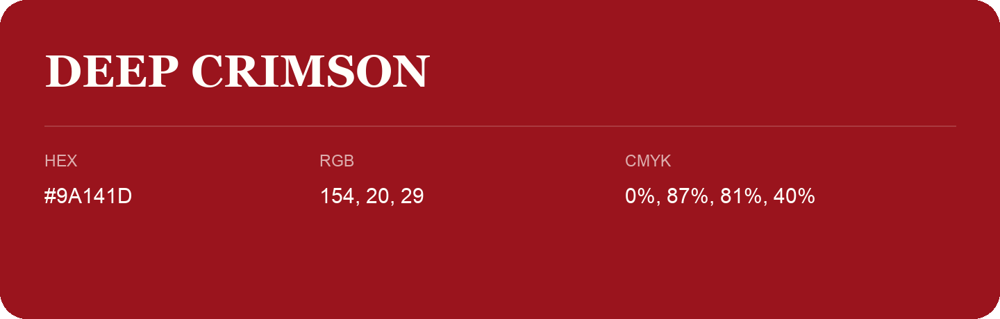

## Deep Crimson

- HEX: #9A141D
- RGB: 154, 20, 29
- CMYK: 0%, 87%, 81%, 40%
- Character: warm, expressive, energetic
- Suggested uses: food brands, expressive identities, promotional accents

- Source images: IMG_8983.JPG
