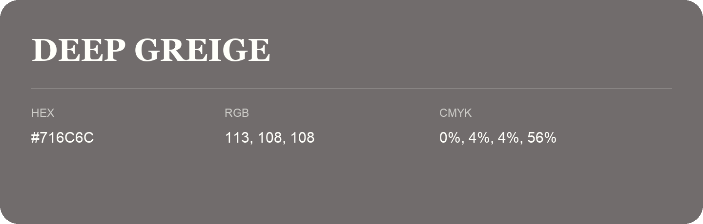

## Deep Greige

- HEX: #716C6C
- RGB: 113, 108, 108
- CMYK: 0%, 4%, 4%, 56%
- Character: restrained, grounded, sophisticated
- Suggested uses: premium brands, editorial typography, dark backgrounds

- Source images: IMG_9045.JPG

- Data provenance: RGB calculated from HEX, matching the page; source image RGB was unreadable.
