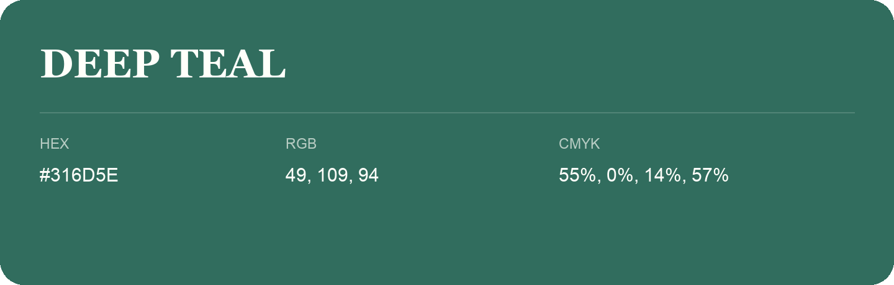

## Deep Teal

- HEX: #316D5E
- RGB: 49, 109, 94
- CMYK: 55%, 0%, 14%, 57%
- Character: calm, fresh, composed
- Suggested uses: wellness brands, coastal hospitality, modern service brands

- Source images: IMG_8989.JPG
