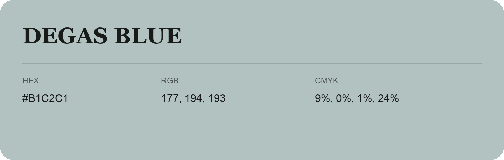

## Degas Blue

- HEX: #B1C2C1
- RGB: 177, 194, 193
- CMYK: 9%, 0%, 1%, 24%
- Character: quiet, balanced, understated
- Suggested uses: professional services, minimal identities, supporting backgrounds

- Source images: IMG_9039.JPG

- Data provenance: HEX recovered from page data; cross-checked against the recognized source text with visually equivalent glyphs.
- Data provenance: RGB calculated from HEX, matching the page; source image RGB was unreadable.
