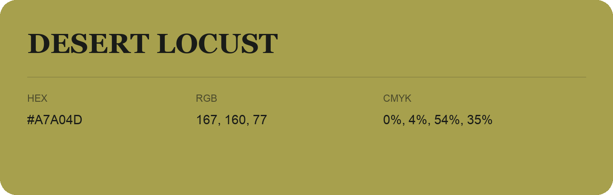

## Desert Locust

- HEX: #A7A04D
- RGB: 167, 160, 77
- CMYK: 0%, 4%, 54%, 35%
- Character: sunny, lively, optimistic
- Suggested uses: friendly consumer brands, food packaging, cheerful accents

- Source images: IMG_8997.JPG
