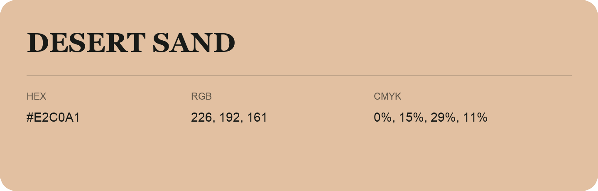

## Desert Sand

- HEX: #E2C0A1
- RGB: 226, 192, 161
- CMYK: 0%, 15%, 29%, 11%
- Character: soft, gentle, approachable
- Suggested uses: friendly consumer brands, gentle backgrounds, welcoming accents

- Source images: IMG_8988.JPG

- Data provenance: HEX recovered from page data; cross-checked against the readable source RGB.
