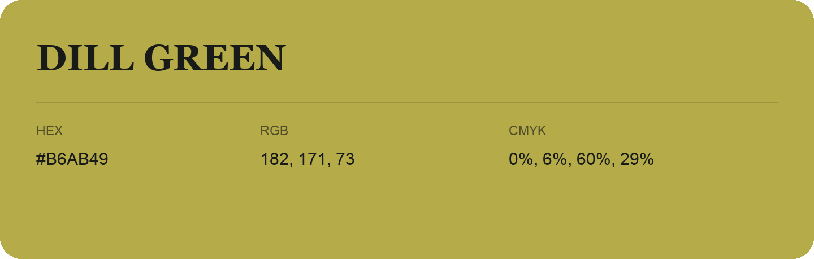

## Dill Green

- HEX: #B6AB49
- RGB: 182, 171, 73
- CMYK: 0%, 6%, 60%, 29%
- Character: sunny, lively, optimistic
- Suggested uses: friendly consumer brands, food packaging, cheerful accents

- Source images: iCloud Photos 2/IMG_9124.JPG
