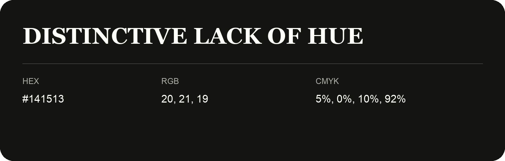

## Distinctive Lack Of Hue

- HEX: #141513
- RGB: 20, 21, 19
- CMYK: 5%, 0%, 10%, 92%
- Character: deep, grounded, understated
- Suggested uses: premium packaging, editorial typography, dark backgrounds

- Source images: iCloud Photos 2/IMG_9136.JPG

- Name note: Other distinct shades share this name: [distinctive-lack-of-hue](distinctive-lack-of-hue.md).
