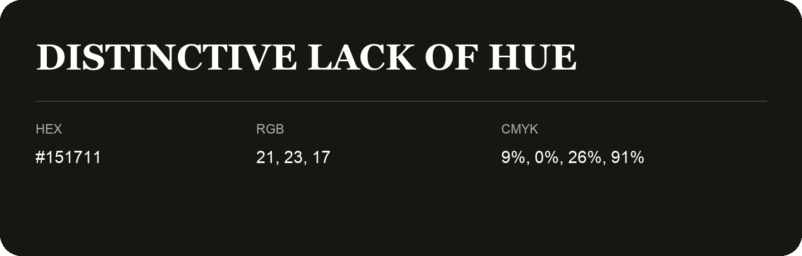

## Distinctive Lack Of Hue

- HEX: #151711
- RGB: 21, 23, 17
- CMYK: 9%, 0%, 26%, 91%
- Character: natural, grounded, fresh
- Suggested uses: outdoor businesses, wellness brands, organic packaging

- Source images: IMG_9026.JPG

- Name note: Other distinct shades share this name: [distinctive-lack-of-hue-141513](distinctive-lack-of-hue-141513.md).
