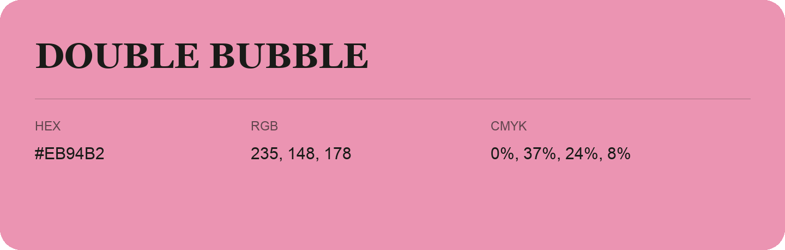

## Double Bubble

- HEX: #EB94B2
- RGB: 235, 148, 178
- CMYK: 0%, 37%, 24%, 8%
- Character: soft, warm, playful
- Suggested uses: friendly consumer brands, gentle backgrounds, welcoming accents

- Source images: IMG_9032.JPG
