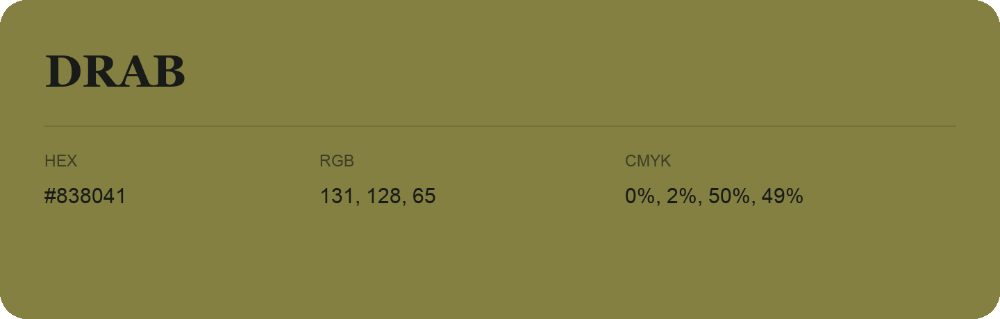

## Drab

- HEX: #838041
- RGB: 131, 128, 65
- CMYK: 0%, 2%, 50%, 49%
- Character: sunny, lively, optimistic
- Suggested uses: friendly consumer brands, food packaging, cheerful accents

- Source images: IMG_9050.JPG
