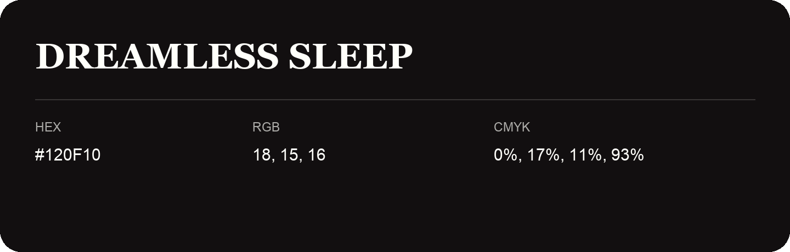

## Dreamless Sleep

- HEX: #120F10
- RGB: 18, 15, 16
- CMYK: 0%, 17%, 11%, 93%
- Character: expressive, imaginative, refined
- Suggested uses: beauty brands, creative businesses, distinctive accents

- Source images: IMG_9097.JPG

- Data provenance: RGB calculated from HEX, matching the page; source image RGB was unreadable.
