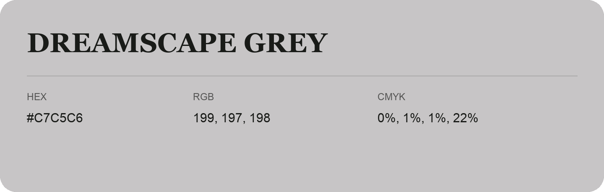

## Dreamscape Grey

- HEX: #C7C5C6
- RGB: 199, 197, 198
- CMYK: 0%, 1%, 1%, 22%
- Character: quiet, balanced, understated
- Suggested uses: professional services, minimal identities, supporting backgrounds

- Source images: IMG_9050.JPG
