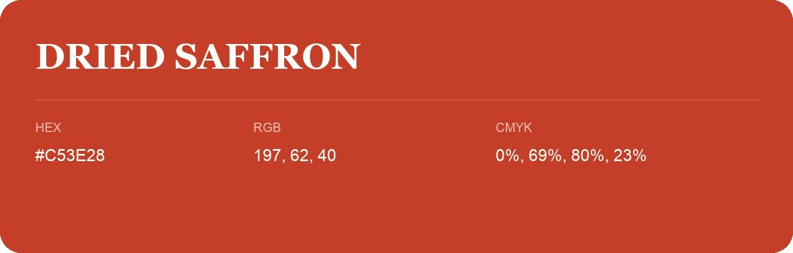

## Dried Saffron

- HEX: #C53E28
- RGB: 197, 62, 40
- CMYK: 0%, 69%, 80%, 23%
- Character: warm, expressive, energetic
- Suggested uses: food brands, expressive identities, promotional accents

- Source images: IMG_9087.JPG
