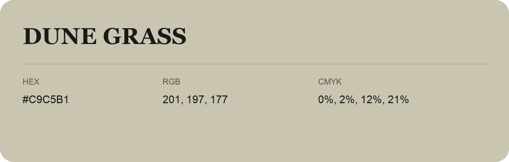

## Dune Grass

- HEX: #C9C5B1
- RGB: 201, 197, 177
- CMYK: 0%, 2%, 12%, 21%
- Character: quiet, balanced, understated
- Suggested uses: professional services, minimal identities, supporting backgrounds

- Source images: IMG_9042.JPG
