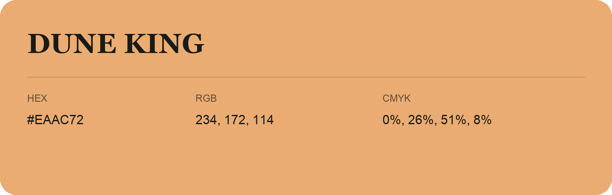

## Dune King

- HEX: #EAAC72
- RGB: 234, 172, 114
- CMYK: 0%, 26%, 51%, 8%
- Character: earthy, rich, warm
- Suggested uses: artisan businesses, hospitality brands, warm accents

- Source images: IMG_9085.JPG
