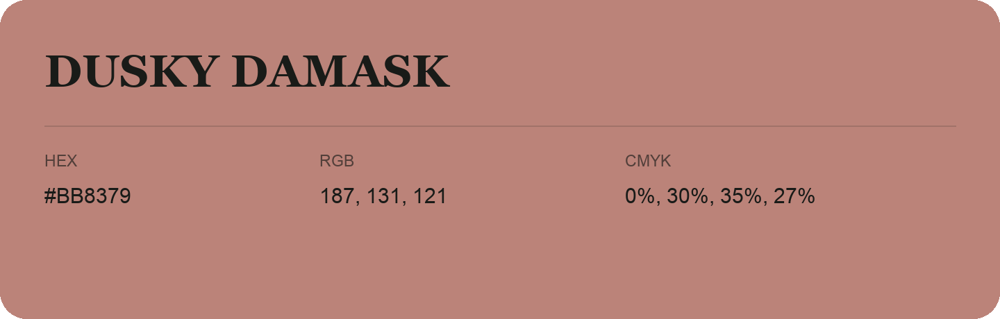

## Dusky Damask

- HEX: #BB8379
- RGB: 187, 131, 121
- CMYK: 0%, 30%, 35%, 27%
- Character: warm, expressive, energetic
- Suggested uses: food brands, expressive identities, promotional accents

- Source images: iCloud Photos 2/IMG_9152.JPG
