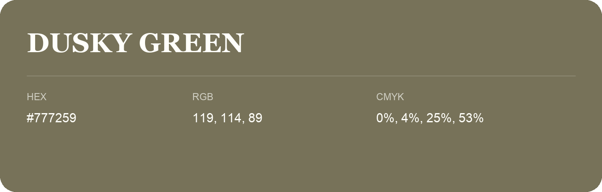

## Dusky Green

- HEX: #777259
- RGB: 119, 114, 89
- CMYK: 0%, 4%, 25%, 53%
- Character: sunny, lively, optimistic
- Suggested uses: friendly consumer brands, food packaging, cheerful accents

- Source images: IMG_9051.JPG
