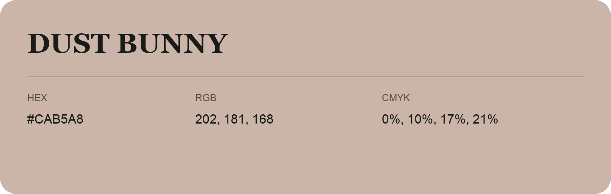

## Dust Bunny

- HEX: #CAB5A8
- RGB: 202, 181, 168
- CMYK: 0%, 10%, 17%, 21%
- Character: soft, gentle, approachable
- Suggested uses: friendly consumer brands, gentle backgrounds, welcoming accents

- Source images: IMG_9114.JPG
