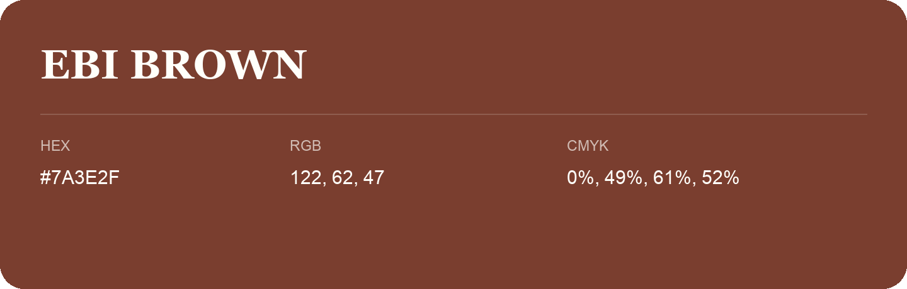

## Ebi Brown

- HEX: #7A3E2F
- RGB: 122, 62, 47
- CMYK: 0%, 49%, 61%, 52%
- Character: warm, expressive, energetic
- Suggested uses: food brands, expressive identities, promotional accents

- Source images: iCloud Photos 2/IMG_9144.JPG
- Data provenance: RGB calculated from HEX; source text recognition was uncertain.
