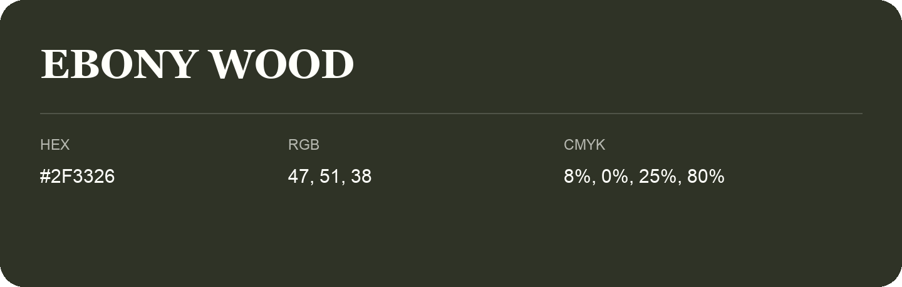

## Ebony Wood

- HEX: #2F3326
- RGB: 47, 51, 38
- CMYK: 8%, 0%, 25%, 80%
- Character: deep, grounded, understated
- Suggested uses: premium packaging, editorial typography, dark backgrounds

- Source images: iCloud Photos 2/IMG_9182.JPG
