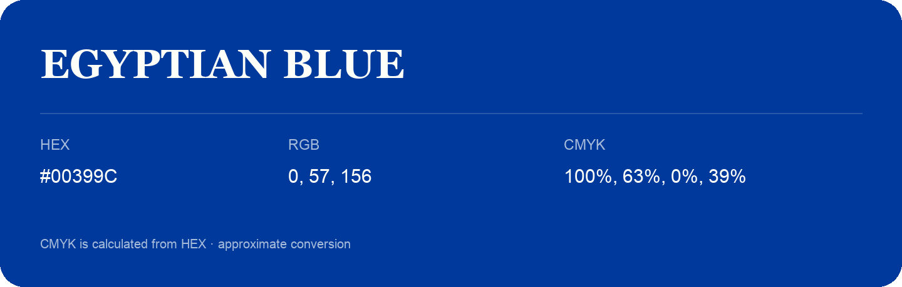

## Egyptian Blue

- HEX: #00399C
- RGB: 0, 57, 156
- CMYK: 100%, 63%, 0%, 39%
- Character: cool, composed, dependable
- Suggested uses: professional services, technology brands, calm backgrounds

- Source images: IMG_8990.JPG

- Data provenance: CMYK calculated from HEX using the page’s conversion; source image CMYK was unreadable. This is an approximate conversion without a print color profile.
