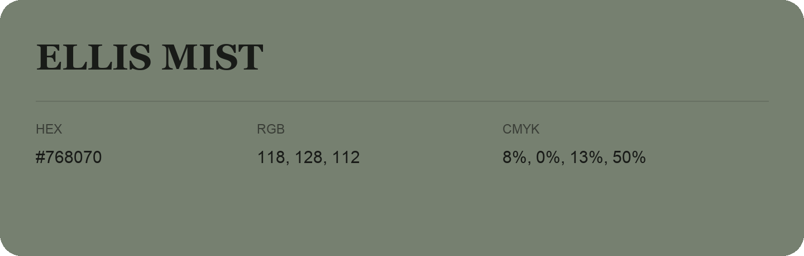

## Ellis Mist

- HEX: #768070
- RGB: 118, 128, 112
- CMYK: 8%, 0%, 13%, 50%
- Character: quiet, balanced, understated
- Suggested uses: professional services, minimal identities, supporting backgrounds

- Source images: IMG_9087.JPG
