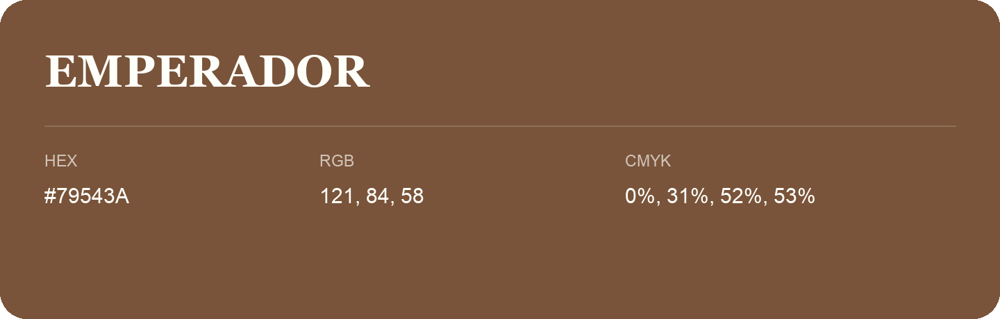

## Emperador

- HEX: #79543A
- RGB: 121, 84, 58
- CMYK: 0%, 31%, 52%, 53%
- Character: earthy, rich, warm
- Suggested uses: premium packaging, rustic brands, dark backgrounds

- Source images: IMG_9058.JPG
