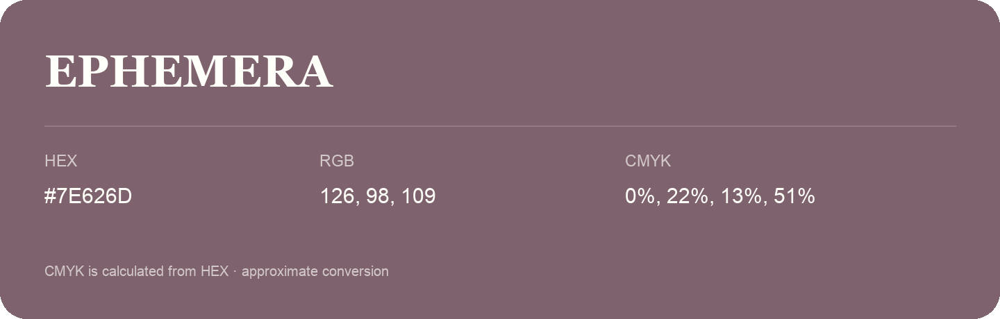

## Ephemera

- HEX: #7E626D
- RGB: 126, 98, 109
- CMYK: 0%, 22%, 13%, 51%
- Character: expressive, imaginative, refined
- Suggested uses: beauty brands, creative businesses, distinctive accents

- Source images: IMG_9006.JPG

- Data provenance: CMYK calculated from HEX using the page’s conversion; source image CMYK was unreadable. This is an approximate conversion without a print color profile.
