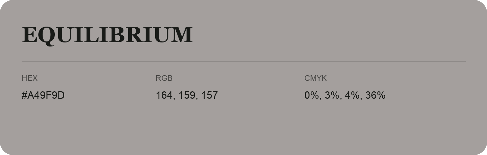

## Equilibrium

- HEX: #A49F9D
- RGB: 164, 159, 157
- CMYK: 0%, 3%, 4%, 36%
- Character: quiet, balanced, understated
- Suggested uses: professional services, minimal identities, supporting backgrounds

- Source images: iCloud Photos 2/IMG_9151.JPG
- Data provenance: RGB calculated from HEX; source text recognition was uncertain.
