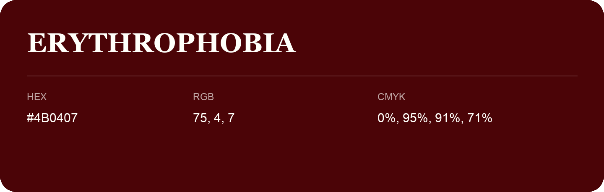

## Erythrophobia

- HEX: #4B0407
- RGB: 75, 4, 7
- CMYK: 0%, 95%, 91%, 71%
- Character: warm, expressive, energetic
- Suggested uses: food brands, expressive identities, promotional accents

- Source images: IMG_9094.JPG
