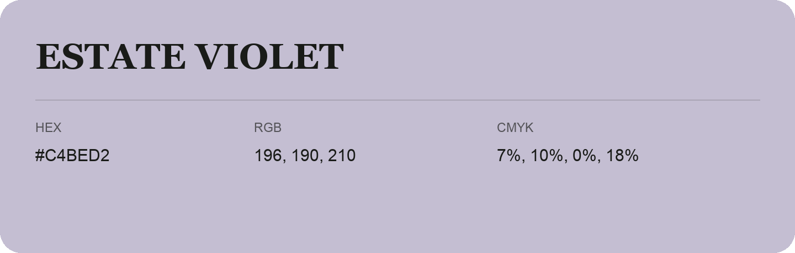

## Estate Violet

- HEX: #C4BED2
- RGB: 196, 190, 210
- CMYK: 7%, 10%, 0%, 18%
- Character: quiet, balanced, understated
- Suggested uses: professional services, minimal identities, supporting backgrounds

- Source images: IMG_9033.JPG
