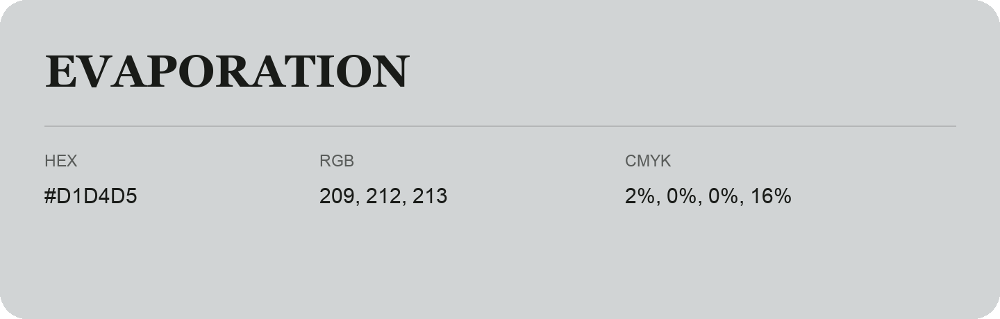

## Evaporation

- HEX: #D1D4D5
- RGB: 209, 212, 213
- CMYK: 2%, 0%, 0%, 16%
- Character: quiet, balanced, understated
- Suggested uses: professional services, minimal identities, supporting backgrounds

- Source images: IMG_9014.JPG
