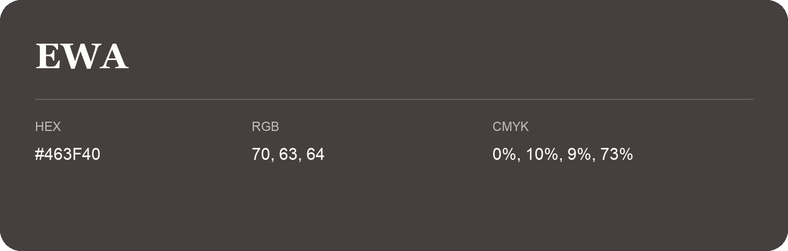

## Ewa

- HEX: #463F40
- RGB: 70, 63, 64
- CMYK: 0%, 10%, 9%, 73%
- Character: restrained, grounded, sophisticated
- Suggested uses: premium brands, editorial typography, dark backgrounds

- Source images: IMG_9117.JPG
