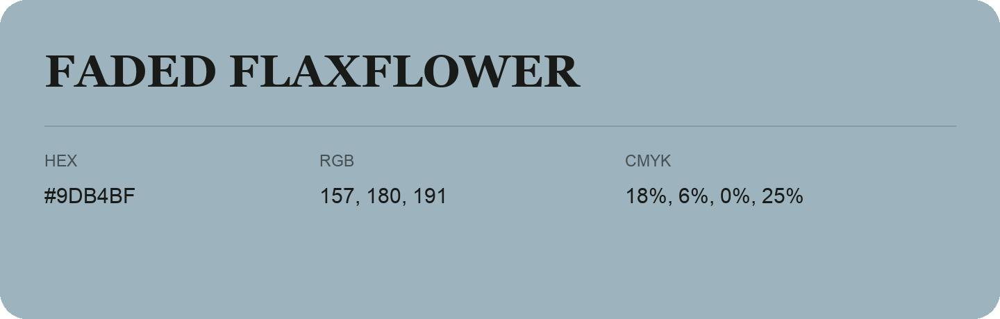

## Faded Flaxflower

- HEX: #9DB4BF
- RGB: 157, 180, 191
- CMYK: 18%, 6%, 0%, 25%
- Character: calm, fresh, composed
- Suggested uses: wellness brands, coastal hospitality, modern service brands

- Source images: iCloud Photos 2/IMG_9187.JPG
- Data provenance: RGB calculated from HEX; source text recognition was uncertain.
