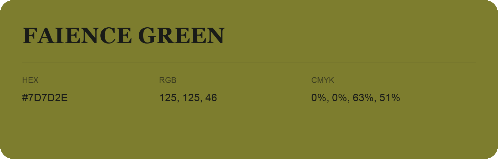

## Faience Green

- HEX: #7D7D2E
- RGB: 125, 125, 46
- CMYK: 0%, 0%, 63%, 51%
- Character: sunny, lively, optimistic
- Suggested uses: friendly consumer brands, food packaging, cheerful accents

- Source images: iCloud Photos 2/IMG_9125.JPG
