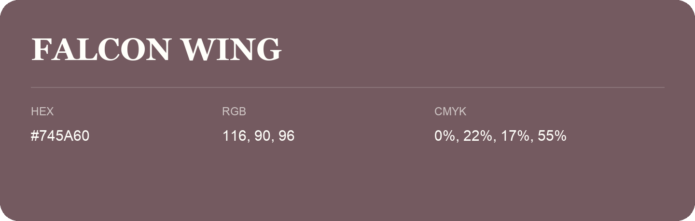

## Falcon Wing

- HEX: #745A60
- RGB: 116, 90, 96
- CMYK: 0%, 22%, 17%, 55%
- Character: warm, expressive, energetic
- Suggested uses: food brands, expressive identities, promotional accents

- Source images: IMG_9028.JPG

- Data provenance: RGB calculated from HEX, matching the page; source image RGB was unreadable.
