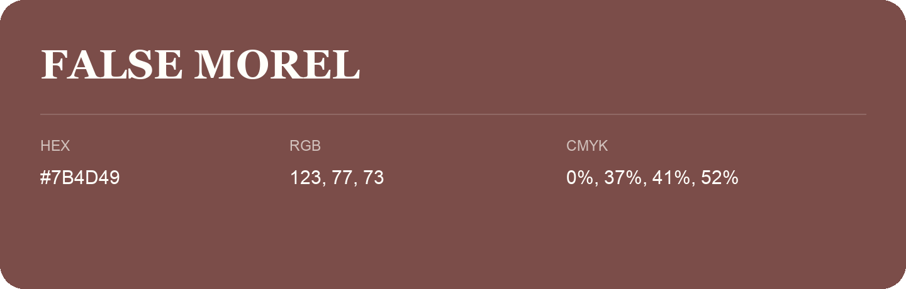

## False Morel

- HEX: #7B4D49
- RGB: 123, 77, 73
- CMYK: 0%, 37%, 41%, 52%
- Character: warm, expressive, energetic
- Suggested uses: food brands, expressive identities, promotional accents

- Source images: iCloud Photos 2/IMG_9172.JPG
