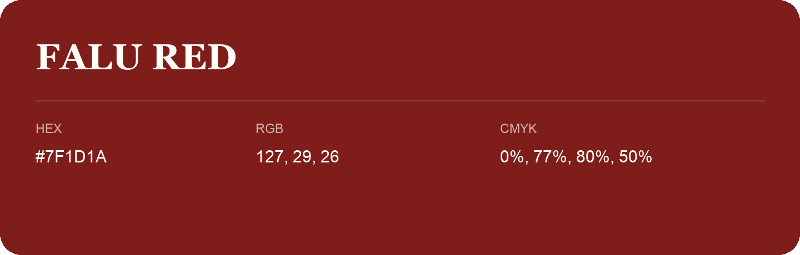

## Falu Red

- HEX: #7F1D1A
- RGB: 127, 29, 26
- CMYK: 0%, 77%, 80%, 50%
- Character: warm, expressive, energetic
- Suggested uses: food brands, expressive identities, promotional accents

- Source images: iCloud Photos 2/IMG_9151.JPG
