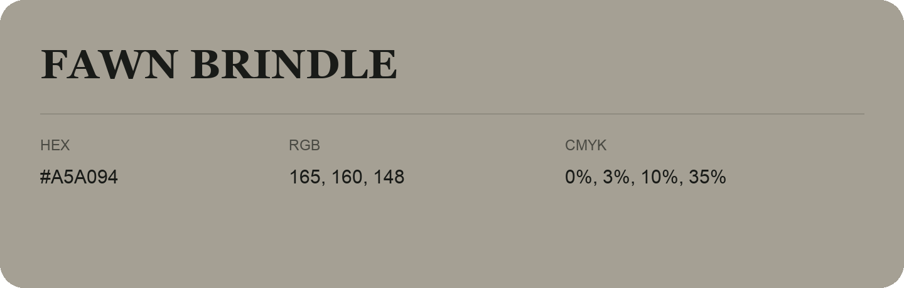

## Fawn Brindle

- HEX: #A5A094
- RGB: 165, 160, 148
- CMYK: 0%, 3%, 10%, 35%
- Character: quiet, balanced, understated
- Suggested uses: professional services, minimal identities, supporting backgrounds

- Source images: IMG_8976.JPG
