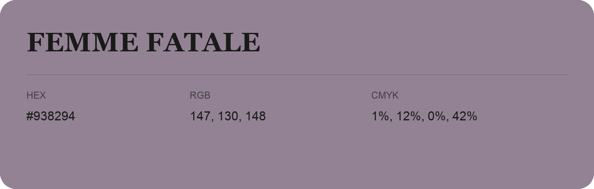

## Femme Fatale

- HEX: #938294
- RGB: 147, 130, 148
- CMYK: 1%, 12%, 0%, 42%
- Character: quiet, balanced, understated
- Suggested uses: professional services, minimal identities, supporting backgrounds

- Source images: iCloud Photos 2/IMG_9137.JPG
- Data provenance: RGB calculated from HEX; source text recognition was uncertain.
