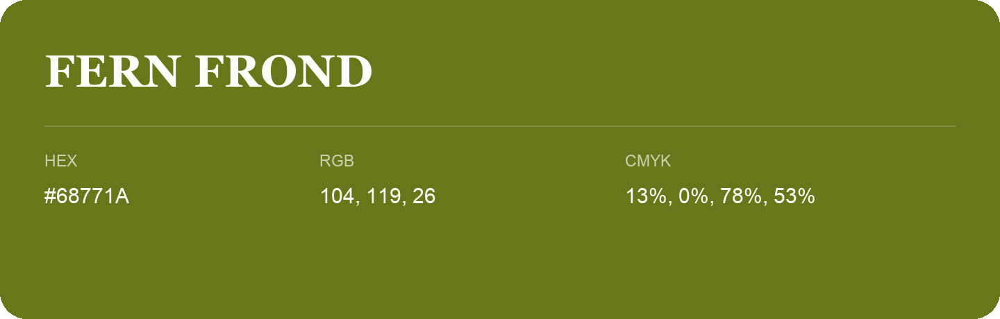

## Fern Frond

- HEX: #68771A
- RGB: 104, 119, 26
- CMYK: 13%, 0%, 78%, 53%
- Character: sunny, lively, optimistic
- Suggested uses: friendly consumer brands, food packaging, cheerful accents

- Source images: iCloud Photos 2/IMG_9139.JPG
- Data provenance: RGB calculated from HEX; source text recognition was uncertain.
