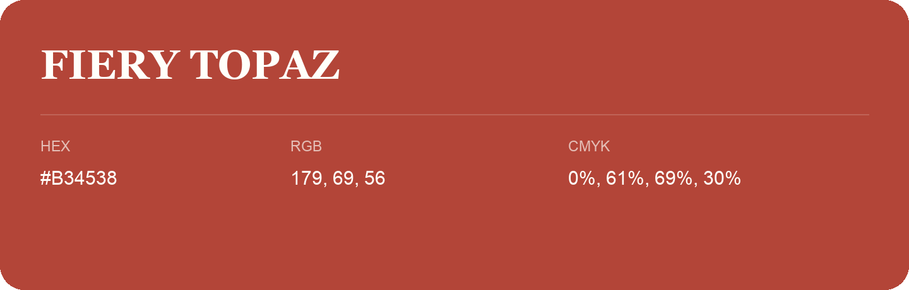

## Fiery Topaz

- HEX: #B34538
- RGB: 179, 69, 56
- CMYK: 0%, 61%, 69%, 30%
- Character: warm, expressive, energetic
- Suggested uses: food brands, expressive identities, promotional accents

- Source images: iCloud Photos 2/IMG_9129.JPG
