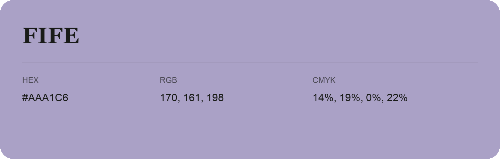

## Fife

- HEX: #AAA1C6
- RGB: 170, 161, 198
- CMYK: 14%, 19%, 0%, 22%
- Character: soft, gentle, approachable
- Suggested uses: friendly consumer brands, gentle backgrounds, welcoming accents

- Source images: iCloud Photos 2/IMG_9175.JPG
