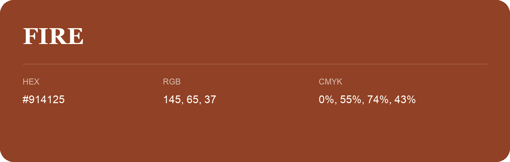

## Fire

- HEX: #914125
- RGB: 145, 65, 37
- CMYK: 0%, 55%, 74%, 43%
- Character: earthy, rich, warm
- Suggested uses: artisan businesses, hospitality brands, warm accents

- Source images: IMG_9080.JPG
