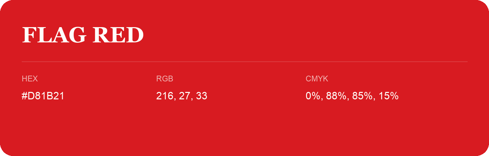

## Flag Red

- HEX: #D81B21
- RGB: 216, 27, 33
- CMYK: 0%, 88%, 85%, 15%
- Character: warm, expressive, energetic
- Suggested uses: food brands, expressive identities, promotional accents

- Source images: IMG_8983.JPG
