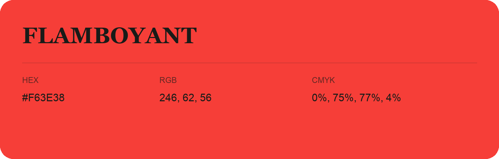

## Flamboyant

- HEX: #F63E38
- RGB: 246, 62, 56
- CMYK: 0%, 75%, 77%, 4%
- Character: warm, expressive, energetic
- Suggested uses: food brands, expressive identities, promotional accents

- Source images: IMG_9051.JPG
