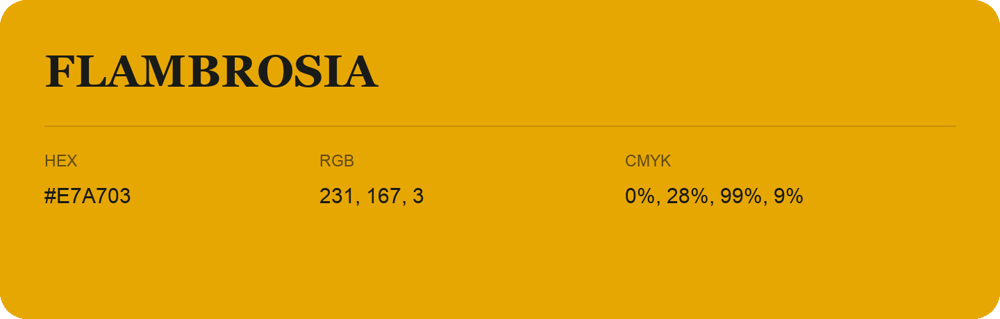

## Flambrosia

- HEX: #E7A703
- RGB: 231, 167, 3
- CMYK: 0%, 28%, 99%, 9%
- Character: earthy, rich, warm
- Suggested uses: artisan businesses, hospitality brands, warm accents

- Source images: iCloud Photos 2/IMG_9138.JPG
