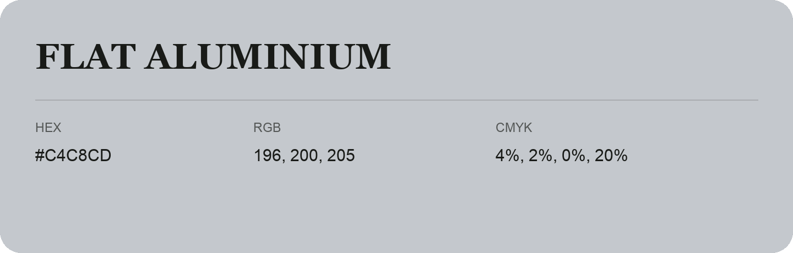

## Flat Aluminium

- HEX: #C4C8CD
- RGB: 196, 200, 205
- CMYK: 4%, 2%, 0%, 20%
- Character: quiet, balanced, understated
- Suggested uses: professional services, minimal identities, supporting backgrounds

- Source images: IMG_9065.JPG
