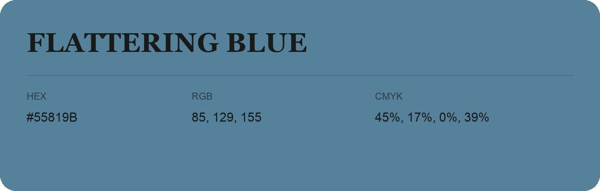

## Flattering Blue

- HEX: #55819B
- RGB: 85, 129, 155
- CMYK: 45%, 17%, 0%, 39%
- Character: cool, composed, dependable
- Suggested uses: professional services, technology brands, calm backgrounds

- Source images: IMG_9103.JPG
