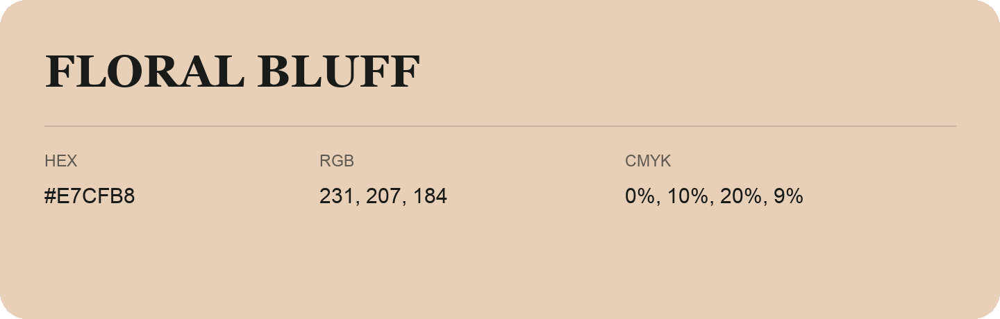

## Floral Bluff

- HEX: #E7CFB8
- RGB: 231, 207, 184
- CMYK: 0%, 10%, 20%, 9%
- Character: soft, gentle, approachable
- Suggested uses: friendly consumer brands, gentle backgrounds, welcoming accents

- Source images: iCloud Photos 2/IMG_9158.JPG
