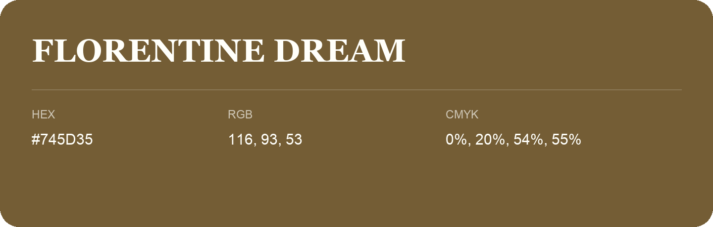

## Florentine Dream

- HEX: #745D35
- RGB: 116, 93, 53
- CMYK: 0%, 20%, 54%, 55%
- Character: earthy, rich, warm
- Suggested uses: premium packaging, rustic brands, dark backgrounds

- Source images: IMG_9066.JPG
