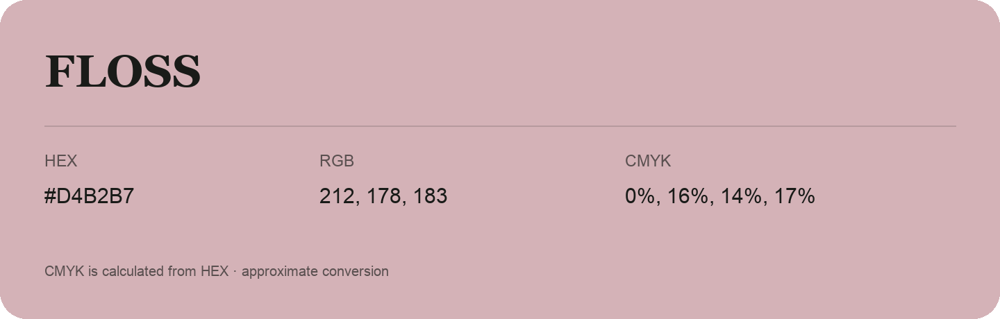

## Floss

- HEX: #D4B2B7
- RGB: 212, 178, 183
- CMYK: 0%, 16%, 14%, 17%
- Character: soft, warm, playful
- Suggested uses: friendly consumer brands, gentle backgrounds, welcoming accents

- Source images: iCloud Photos 2/IMG_9146.JPG
- Data provenance: CMYK calculated from HEX; source text recognition was uncertain. Approximate conversion without a print color profile.
