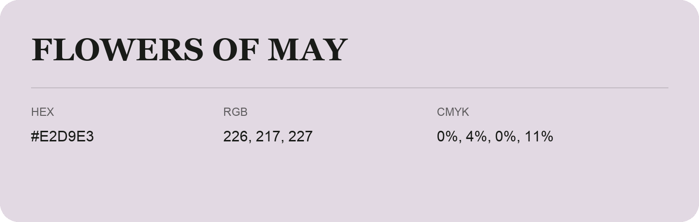

## Flowers Of May

- HEX: #E2D9E3
- RGB: 226, 217, 227
- CMYK: 0%, 4%, 0%, 11%
- Character: quiet, balanced, understated
- Suggested uses: professional services, minimal identities, supporting backgrounds

- Source images: iCloud Photos 2/IMG_9183.JPG
- Data provenance: RGB calculated from HEX; source text recognition was uncertain.
